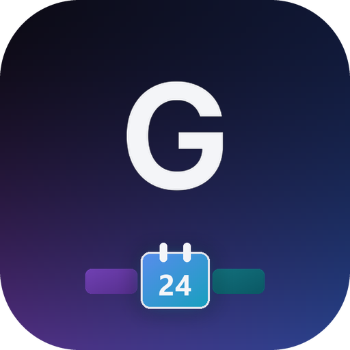

🇩🇪 <a href="CHANGELOG.md">Deutsch</a> &nbsp;·&nbsp; 🇬🇧 <b>English</b>

# Changelog

**Everything new in Gimbo Kalender, latest version first.**

[Download](../../releases/latest) · [README](README.en.md)

## 0.9.0-alpha

- Month, week, day, agenda and overview
- Recurring events, categories and up to five reminders
- Notebook with checklists and tasks
- Customisable home screen widgets
- Shared account calendars via Google, Microsoft or CalDAV
- 33 languages selectable in the app, German and English complete
- Completely free, no ads and no account
