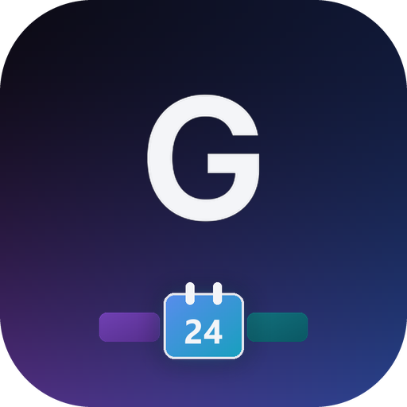

🇩🇪 <b>Deutsch</b> &nbsp;·&nbsp; 🇬🇧 <a href="CHANGELOG.en.md">English</a>

# Änderungen

**Alle Neuerungen im Gimbo Kalender, die neueste Version zuerst.**

[Download](../../releases/latest) · [README](README.md)

## 0.9.0-alpha

- Monat, Woche, Tag, Agenda und Übersicht
- Serien, Kategorien und bis zu fünf Erinnerungen
- Notizblock mit Checklisten und Aufgaben
- Anpassbare Widgets für den Startbildschirm
- Gemeinsame Kontokalender über Google, Microsoft oder CalDAV
- 33 Sprachen in der App wählbar, Deutsch und Englisch vollständig
- Komplett kostenlos, ohne Werbung und ohne Konto
