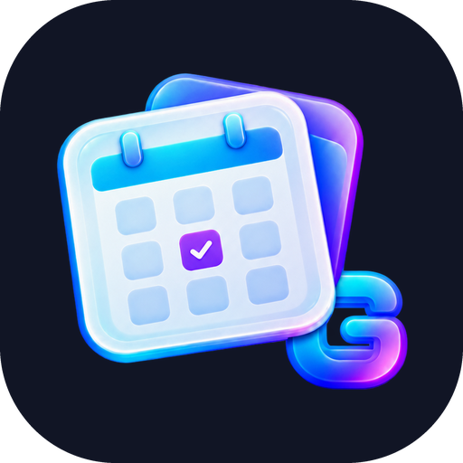
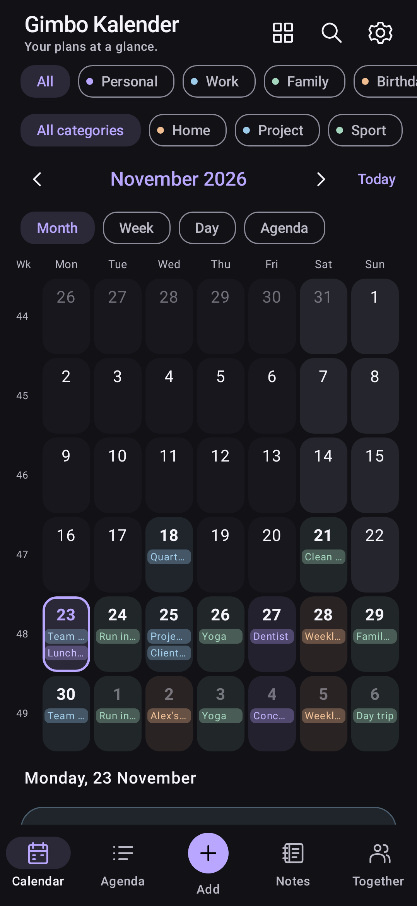
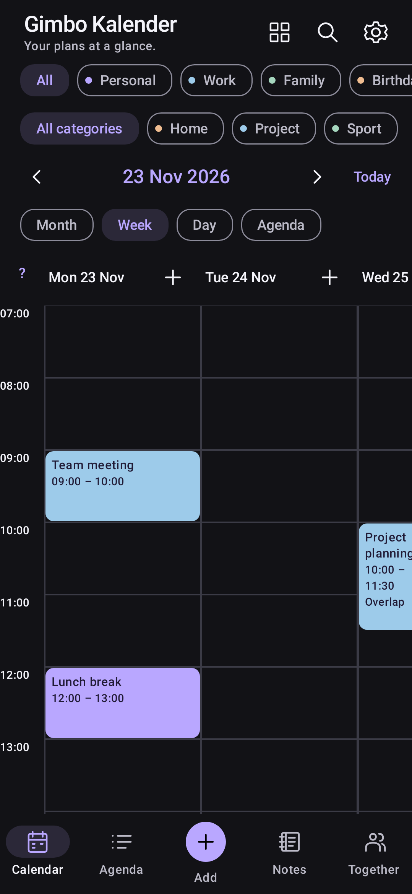
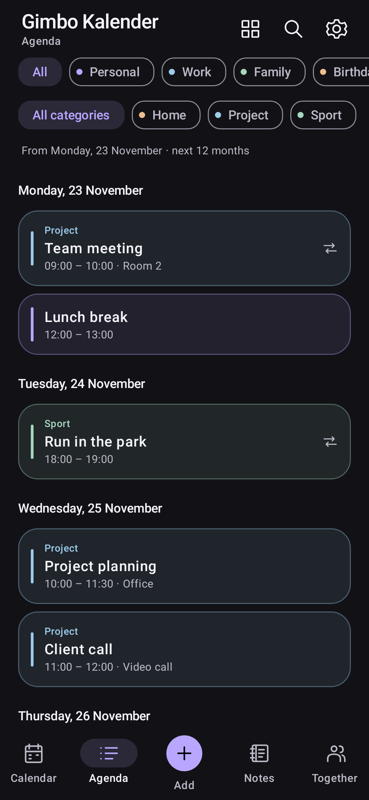
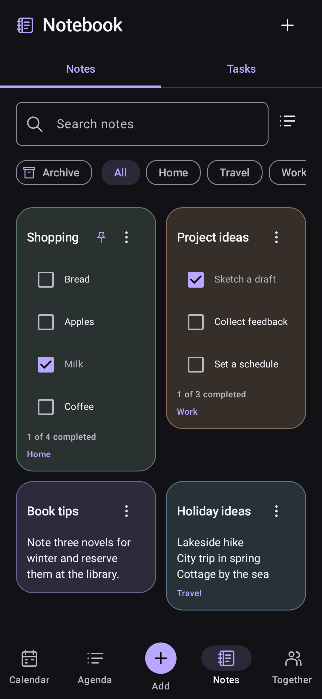

🇩🇪 <a href="README.md">Deutsch</a> &nbsp;·&nbsp; 🇬🇧 <b>English</b>

# Gimbo Kalender

**Events, tasks and notes in one place.**

`0.9.0-alpha` · Android 10+ · Kotlin & Jetpack Compose

[**Download APK**](../../releases/latest)

  
  
  
  

## Features

| | |
|---|---|
| **Views** | Month, week, day, agenda, overview and search |
| **Events** | Recurring events, single-occurrence edits, templates, categories and up to five reminders |
| **Notes & tasks** | Text notes, checklists, labels, archive and recurring tasks |
| **Widgets** | Month, week, day or agenda with adjustable colours, text size and transparency |
| **Plan together** | Shared account calendars via Google, Microsoft or CalDAV accounts already set up on the device |
| **Extras** | Public holidays, school holidays, birthdays, attachments, weather and travel planning, all optional |
| **Data** | Local and without an account, backup as JSON/ZIP, exchange via ICS and VTODO |
| **Languages** | Selectable in the app: 33 languages, German and English fully translated |

Completely free, no ads and no account.

## Development

Requires JDK 21 and Android SDK 36. Set the SDK path via `ANDROID_HOME` or `local.properties`.

| Command | Result |
|---|---|
| `./gradlew assembleDebug` | Debug APK |
| `./gradlew testDebugUnitTest lintDebug` | Tests and lint |
| `./gradlew bundleRelease` | Release bundle |
| `./gradlew testDebugUnitTest -Pscreenshots --tests '*StoreScreenshots*'` | Screenshots in `docs/screenshots` |

## Licence and legal

© 2026 Hiarni · All rights reserved. The source code is visible but may not be copied, modified or distributed without permission.

| | |
|---|---|
| [Licence](LICENSE) | Terms for code and app |
| [Third-party notices](THIRD_PARTY_NOTICES.md) | Open source libraries, data sources and trademarks |
| [Privacy policy](PRIVACY.en.md) | Which data is processed where |

Android is a trademark of Google LLC.

---

© Hiarni

