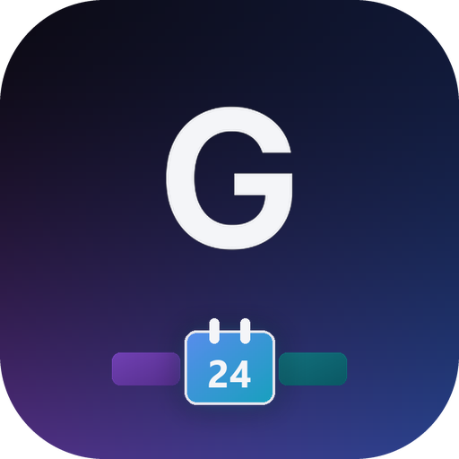
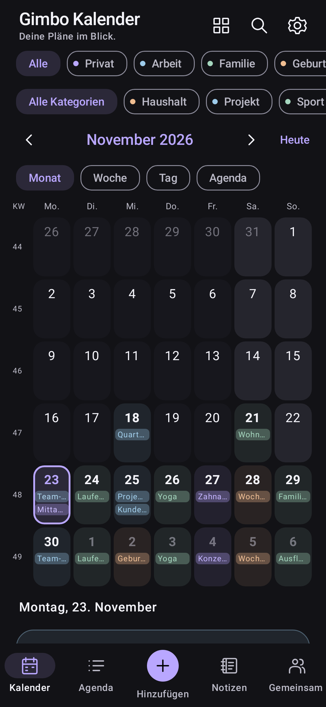
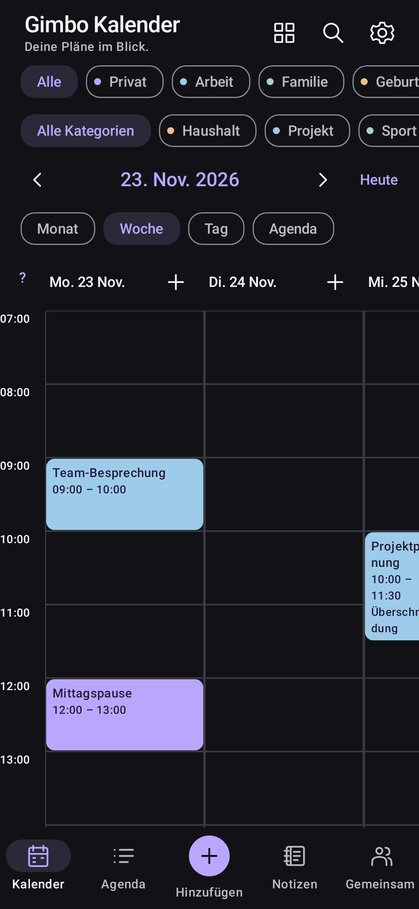
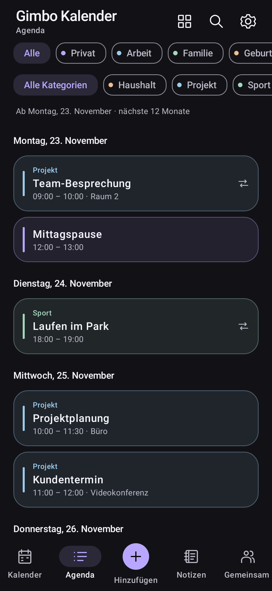
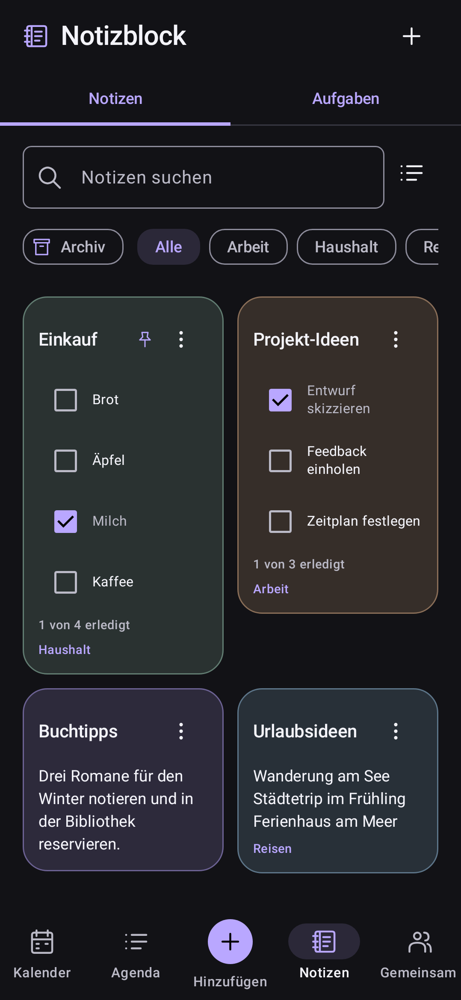

🇩🇪 <b>Deutsch</b> &nbsp;·&nbsp; 🇬🇧 <a href="README.en.md">English</a>

# Gimbo Kalender

**Termine, Aufgaben und Notizen an einem Ort.**

`0.9.0-alpha` · Android 10+ · Kotlin & Jetpack Compose

[**APK herunterladen**](../../releases/latest) · [Änderungen](CHANGELOG.md)

  
  
  
  

## Funktionen

| | |
|---|---|
| **Ansichten** | Monat, Woche, Tag, Agenda, Übersicht und Suche |
| **Termine** | Serien, Einzeländerungen, Vorlagen, Kategorien und bis zu fünf Erinnerungen |
| **Notizen & Aufgaben** | Textnotizen, Checklisten, Etiketten, Archiv und wiederkehrende Aufgaben |
| **Widgets** | Monat, Woche, Tag oder Agenda mit anpassbaren Farben, Schrift und Transparenz |
| **Gemeinsam planen** | Kontokalender über Google, Microsoft oder CalDAV, die schon auf dem Gerät eingerichtet sind |
| **Extras** | Feiertage, Schulferien, Geburtstage, Anhänge, Wetter und Reiseplanung, jeweils optional |
| **Daten** | Lokal und ohne Konto, Sicherung als JSON/ZIP, Austausch per ICS und VTODO |
| **Sprachen** | In der App wählbar: 33 Sprachen, Deutsch und Englisch vollständig übersetzt |

Komplett kostenlos, ohne Werbung und ohne Konto.

## Entwicklung

Benötigt JDK 21 und das Android SDK 36. Den SDK-Pfad über `ANDROID_HOME` oder `local.properties` angeben.

| Befehl | Ergebnis |
|---|---|
| `./gradlew assembleDebug` | Debug-APK |
| `./gradlew testDebugUnitTest lintDebug` | Tests und Lint |
| `./gradlew bundleRelease` | Release-Bundle |
| `./gradlew testDebugUnitTest -Pscreenshots --tests '*StoreScreenshots*'` | Screenshots in `docs/screenshots` |

## Lizenz und Rechtliches

© 2026 Hiarni · Alle Rechte vorbehalten. Der Quellcode ist einsehbar, darf aber ohne Zustimmung nicht kopiert, verändert oder weitergegeben werden.

| | |
|---|---|
| [Lizenz](LICENSE) | Nutzungsbedingungen für Code und App |
| [Drittanbieter-Hinweise](THIRD_PARTY_NOTICES.md) | Open-Source-Bibliotheken, Datenquellen und Marken |
| [Datenschutz](PRIVACY.md) | Welche Daten wo verarbeitet werden |

Android ist eine Marke von Google LLC.

---

© Hiarni

